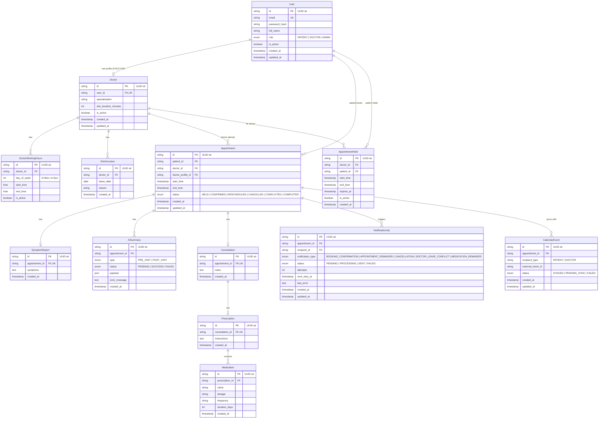
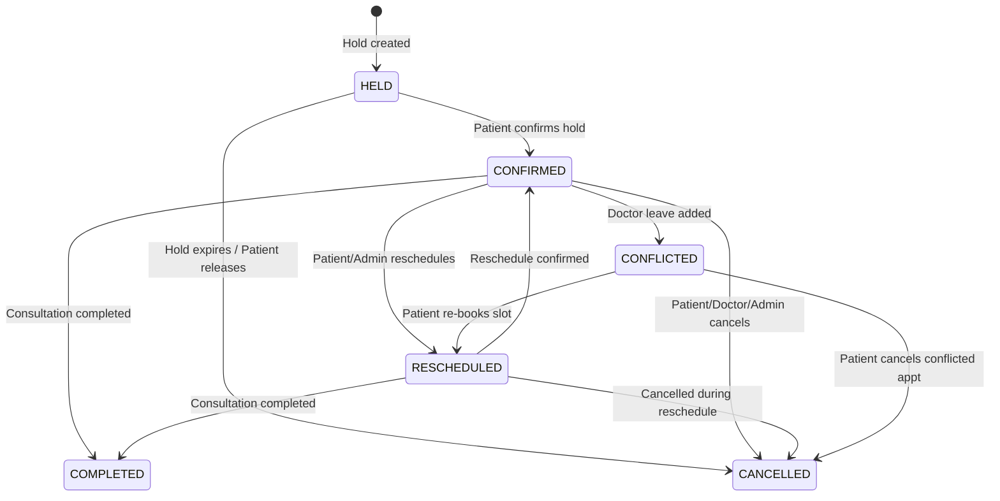
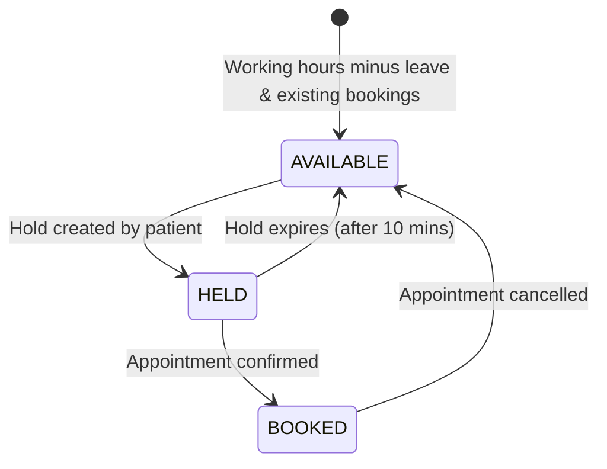
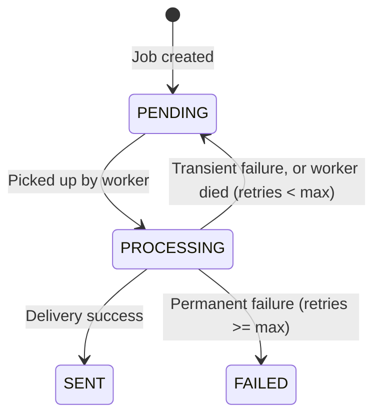

# Database Design

## Overview

The database uses PostgreSQL with SQLAlchemy ORM and Alembic migrations.
The relational design enforces data integrity, appointment state consistency, and double-booking prevention.
All tables are created from zero via Alembic migrations.

---

## Entity Relationship Diagram




---

## State Machines

### 1. Appointment State Machine



**State Definitions:**
- **HELD**: Slot temporarily reserved for patient (temporary state before confirmation)
- **CONFIRMED**: Booking finalized and active
- **RESCHEDULED**: Moved to a new time slot
- **CANCELLED**: Booking terminated; slot released
- **CONFLICTED**: Doctor leave overlaps this booking; requires patient action
- **COMPLETED**: Consultation finished by doctor

### 2. Slot State Machine



**State Definitions:**
- **AVAILABLE**: Slot exists in working hours, no active hold, no booking, no leave
- **HELD**: Temporarily held by a patient (blocks other holds/bookings)
- **BOOKED**: Occupied by a CONFIRMED appointment

### 3. Notification Job State Machine



**State Definitions:**
- **PENDING**: Scheduled for delivery
- **PROCESSING**: In-flight by notification worker. A job still here after `NOTIFICATION_PROCESSING_TIMEOUT_MINUTES` had its worker die and is requeued, so delivery is at-least-once
- **SENT**: Successfully delivered via provider
- **FAILED**: Permanent failure after maximum retry attempts (e.g. 3 attempts)

---

## Constraints & Integrity Rules

### Double-Booking Prevention
1. **Partial unique index** on `(doctor_profile_id, start_time)` for active appointments (same start time):
   ```sql
   CREATE UNIQUE INDEX uq_doctor_profile_start_time_active
   ON appointments (doctor_profile_id, start_time)
   WHERE status IN ('HELD', 'CONFIRMED', 'RESCHEDULED');
   ```
2. **Exclusion constraint** (PostgreSQL, migration `a3c5d7e9f1b2`; needs `btree_gist`) for any overlap, whatever the start times:
   ```sql
   ALTER TABLE appointments ADD CONSTRAINT ex_doctor_profile_no_overlap_active
   EXCLUDE USING gist (doctor_profile_id WITH =, tstzrange(start_time, end_time) WITH &&)
   WHERE (status IN ('HELD', 'CONFIRMED', 'RESCHEDULED'));
   ```
   SQLite (tests, local dev) enforces the same rule with `BEFORE INSERT` / `BEFORE UPDATE` triggers. The migration fails if existing data already has overlapping active appointments for a doctor; cancel or move one of each pair first.
3. **Explicit Row Locking:**
   Booking and rescheduling run `SELECT ... FOR UPDATE` on the overlap query and on the appointment being rescheduled or cancelled. This reduces conflict churn but is not relied on for correctness: a free slot returns no rows to lock. Constraints 1 and 2 are the final authority.

### Other tables and columns (added later)
- `doctors.timezone` (varchar(64), default `'UTC'`): IANA zone the doctor's working hours and leave dates are written in.
- `users.token_version` (int, default 0): bumped by logout; access tokens carry it and are rejected on mismatch.
- `login_throttles(key PK, failed_count, window_started_at, locked_until)`: failed-login counters, `key` = SHA-256 of `email|client IP`.
- `appointment_holds`: partial unique index `uq_active_hold_doctor_start_time` on `(doctor_id, start_time) WHERE is_active`.
- `users.email_verified` (bool, not null): false until the emailed link is followed. Pre-existing rows and admin-created doctors are true.
- `rate_limits(key PK, count, window_started_at)`: fixed-window request counters; `key` = SHA-256 of `bucket|identity`.
- `auth_tokens(id PK, user_id FK, purpose, token_hash UNIQUE, expires_at, used_at, created_at)`: single-use password-reset and email-verification tokens; only the hash is stored.
- `audit_logs(id PK, occurred_at, actor_user_id, actor_role, action, resource_type, resource_id, patient_id, ip, detail)`: append-only, deliberately no foreign keys, indexed on time, actor, action, resource and patient.
- `notificationtype` enum gained `PASSWORD_RESET` and `EMAIL_VERIFICATION`. On PostgreSQL the migration runs `ALTER TYPE ... ADD VALUE` outside a transaction block; PostgreSQL cannot remove an enum value, so a downgrade leaves them (unused).

### Doctor Leave Constraint
- Doctor leave dates prevent slot generation for the full 24-hour day of the leave date.
- Leave creation executes in a transaction that queries overlapping `CONFIRMED` appointments, updates their status to `CONFLICTED`, and enqueues `NotificationJob` records for affected patients.
