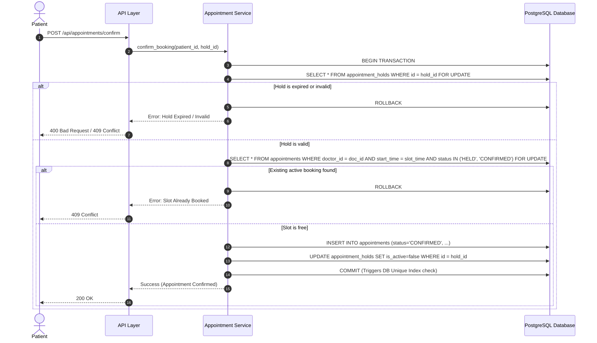
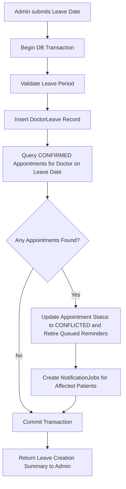
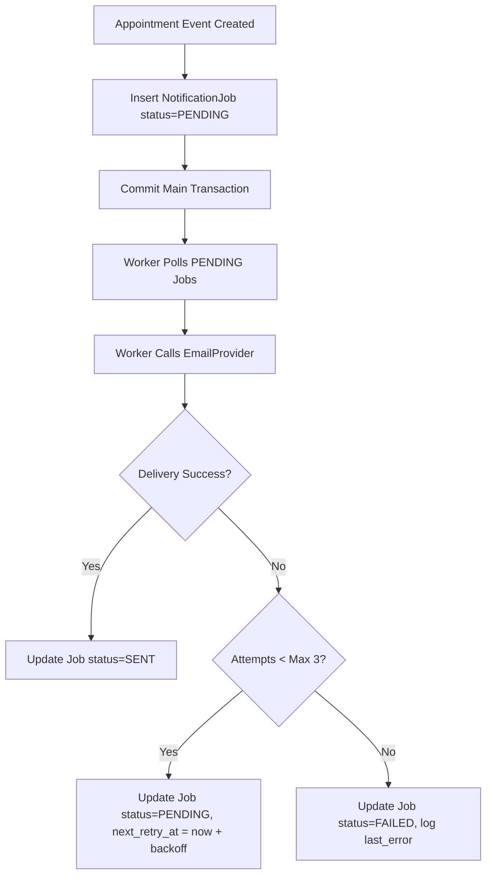

# System Design

This document details the core reliability mechanisms of the Healthcare Appointment & Follow-up Manager.

---

## 1. Double-Booking Prevention Strategy

Preventing double-booking requires a multi-layered defence where the database is the final authority.

### Key Controls:
1. **Row-Level Locking:** `SELECT ... FOR UPDATE` on the overlap query reduces conflict churn. It cannot be the guarantee: when the slot is free the query returns no rows, so there is nothing to lock.
2. **Database Constraints (the final authority):**
   - Partial unique index `uq_doctor_profile_start_time_active` rejects two active appointments with the same start time.
   - On PostgreSQL, exclusion constraint `ex_doctor_profile_no_overlap_active` (`btree_gist`, `tstzrange(start_time, end_time) WITH &&`) rejects any two *overlapping* active appointments for one doctor, whatever their start times. Back-to-back slots are allowed. On SQLite (tests, local dev) two triggers enforce the same rule.
   - "Active" means `HELD`, `CONFIRMED` or `RESCHEDULED`. A violation raises `IntegrityError`, which the repositories translate to a 409.
3. **Atomic hold release:** the hold is flushed inactive but committed *together with* the appointment insert. If the insert loses a race the whole transaction rolls back and the patient keeps their hold (`test_failed_hold_confirmation_keeps_the_hold`).

---

## 2. Doctor Leave Conflict Workflow

When an admin marks a doctor as on leave for a specific date:

### Key Controls:
- **Atomicity:** Leave creation and appointment status conversion to `CONFLICTED` occur within the same database transaction.
- **Data Preservation:** Appointments are marked `CONFLICTED`, preserving historical details for rescheduling without data loss.
- **Leave vs. booking:** leave creation, booking and rescheduling all lock the doctor's row first (then appointment rows, always in that order, so they cannot deadlock). A booking in flight finishes before the leave looks for conflicts; one that starts later waits and then sees the leave. Two admins adding the same date are serialised too, and a lost race is a 409 (`uq_doctor_leave_date`). PostgreSQL only: SQLite has no row locks and the suite cannot exercise this.
- **Stale notifications:** conflicting an appointment (like cancelling one) retires its unsent reminder *and* booking-confirmation jobs, so nobody is told "confirmed" about an appointment that is already gone.
- **Privacy:** the public `GET /doctors/{id}/leaves` returns dates only; the free-text `reason` is shown to admins.

---

## 3. Slot Hold Mechanism

To prevent race conditions while a patient fills out symptom forms:

1. **Hold Request:** Patient selects a slot; `HoldService` creates an `AppointmentHold` record with `expires_at = now() + 10 minutes`.
2. **Hold Exclusions:** Slot generation logic ignores slots with active, non-expired holds. A partial unique index (`uq_active_hold_doctor_start_time` on `appointment_holds(doctor_id, start_time) WHERE is_active`) guarantees one active hold per slot even when two requests pass the application check together; the loser gets a 409.
3. **Automatic Expiry:** Every read ignores holds whose `expires_at` has passed, and `GET` reports such a hold as inactive without writing. Creating a hold on a slot first deactivates that slot's own expired hold; `HoldExpiryWorker` sweeps the rest as housekeeping.
4. **Confirmation Guard:** Attempting to confirm an expired hold rejects the transaction and forces slot re-selection. So does confirming a hold whose slot stopped being valid while it was held, such as when leave was added for that date (409).

---

## 4. Notification Failure Handling & Retries

Notifications must never break appointment creation or state transitions.

### Key Controls:
- **Decoupled Delivery:** Email provider calls happen asynchronously via workers.
- **Exponential Backoff:** Retries are delayed (e.g., 1 min, 5 min, 15 min).
- **Idempotency:** Jobs are locked during processing (`PROCESSING` state) to prevent duplicate delivery by parallel worker loops.
- **Crash Recovery:** A job a dead worker left in `PROCESSING` is requeued after `NOTIFICATION_PROCESSING_TIMEOUT_MINUTES`, counting as an attempt.

---

## 5. Timezones

Working hours and leave dates are wall-clock values in the **doctor's** timezone (`doctors.timezone`, an IANA name, default `UTC`). Appointments, holds and slots are absolute instants stored in UTC.

- `SlotService` converts through the doctor's zone: a slot request's date is the doctor's local date, and a booking's weekday, leave date and working-hours window are decided from its local time. Slots are stepped in UTC after conversion, so they are exactly one slot long even across a daylight-saving change (a DST day is 23 or 25 hours).
- A leave on a date covers that date's local day, so it conflicts an appointment at Tuesday 00:00 IST even though that instant is Monday in UTC.
- Emails and the portals show times in the doctor's zone, labelled (`09:00 IST`). Changing a doctor's timezone moves their *hours*, not bookings that already exist.

---

## 6. Authentication Hardening

- **Login throttling:** failures are counted per (email, client IP) in the `login_throttles` table, so the limit holds across instances. `LOGIN_MAX_FAILED_ATTEMPTS` (5) consecutive failures lock that pair out for `LOGIN_LOCKOUT_MINUTES` (15) with HTTP 429 and `Retry-After`. Unknown emails are throttled identically and cost the same bcrypt work as a real account, so neither status nor timing reveals which emails exist. The IP is part of the key so a stranger cannot lock a real user out; behind a proxy the server must be started with `--proxy-headers` (the Render blueprint does) or every client shares the proxy's IP.
- **Token revocation:** each token carries the user's `token_version` (`tv`). `POST /auth/logout` bumps it, so a copied or stolen token stops working, not just the browser's copy. Tokens issued before the field existed count as version 0.
- **Where the token lives:** by default the frontend keeps it in `localStorage` (works across sites, e.g. Vercel + Render). That is readable by any script injected into the page, so the frontend ships a Content-Security-Policy (`script-src 'self'`) that blocks injected scripts, and logout revokes the token server-side.
- **Cookie mode (opt-in):** with `AUTH_COOKIE_MODE=True` on the API and `VITE_AUTH_COOKIES=true` in the frontend build, login sets the token in an `httpOnly` cookie (`Secure`, `SameSite=Lax`) and the response body carries none, so there is nothing for a script to steal. It needs the app and API on the **same site** (e.g. `app.example.com` + `api.example.com`); a cross-site setup would need `SameSite=None` cookies, which browsers increasingly block. Cookie-authenticated requests that change state must send `X-CSRF-Protection` (a cross-site page cannot add a custom header without a CORS preflight that only allow-listed origins pass); GETs and Bearer-token requests are unaffected. CORS then allows credentials, for the explicit origin allow-list only.

---

## 7. Other Guards

- **AI cost cap:** at most `AI_MAX_SUMMARIES_PER_APPOINTMENT` (10) summaries per appointment and type, failures included, then HTTP 429. The request commits (freeing its pooled DB connection) before the slow LLM call.
- **SMTP:** `STARTTLS` verifies the server certificate and hostname.
- **Medication reminder emails** say a reminder is due and point to the app; they never name the drug, dose or frequency.
- **Consultation timing:** `CONSULTATION_EARLY_SUBMIT_MINUTES` (unset by default) rejects a consultation recorded more than that long before the appointment starts. It is off by default because the demo flow books a future slot and consults straight away; set it (e.g. 15) for a real clinic.
- **Calendar:** a leave that conflicts an appointment also queues deletion of its calendar events (after the leave commits, best-effort, like every other calendar step).
